  <picture></picture>

  
  
  
  

## Tech stack

  <picture></picture> 
  
  
  
  
  
  

  <picture></picture> 
  
  
  
  
  

  <picture></picture> 
  
  
  
  
  
  

  <picture></picture> 
  
  
  
  
  

  <picture></picture> 
  
  
  
  

  <picture></picture> 
  
  
  

  <picture></picture> 
  
  
  
  

  <picture></picture> 
  
  

  <picture></picture> 
  
  
  

  <picture></picture> 
  
  
  
  

